<p align="center">
  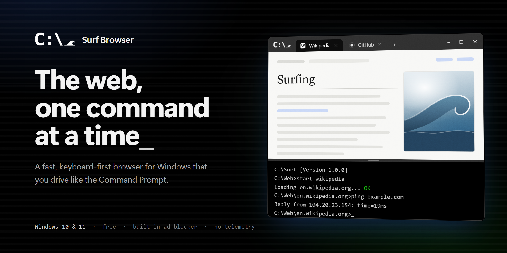
</p>

<p align="center">
  <strong>A fast, keyboard-first web browser for Windows that you drive like the Command Prompt.</strong><br>
  Type <code>youtube</code>, press Enter, and you are there. Everything else is a command away.
</p>

<p align="center">
  <a href="https://github.com/gajishere/surf-browser-releases/releases/latest">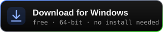</a>
</p>

<p align="center">
  <a href="https://github.com/gajishere/surf-browser-releases/releases/latest"></a>
  <a href="https://github.com/gajishere/surf-browser-releases/releases"></a>
  
  
</p>

<p align="center">
  <a href="#features">Features</a> &nbsp;·&nbsp;
  <a href="#get-started">Get started</a> &nbsp;·&nbsp;
  <a href="docs/COMMANDS.md">Commands</a> &nbsp;·&nbsp;
  <a href="docs/SHORTCUTS.md">Shortcuts</a> &nbsp;·&nbsp;
  <a href="docs/SETTINGS.md">Settings</a> &nbsp;·&nbsp;
  <a href="docs/PRIVACY.md">Privacy</a> &nbsp;·&nbsp;
  <a href="CHANGELOG.md">Changelog</a>
</p>

---

<p align="center">
  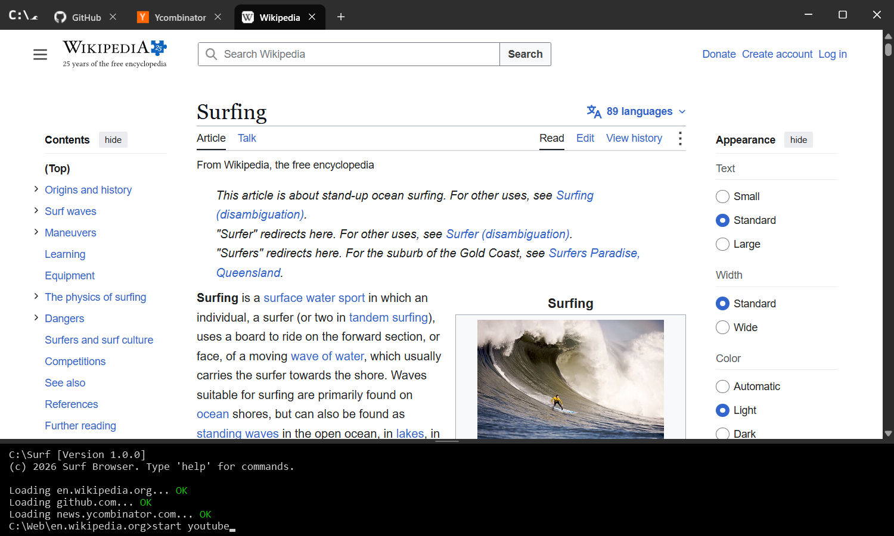
</p>

## What Surf is

Surf is a web browser with no toolbar. The page fills the window, your tabs sit in the title bar like Windows Terminal, and a black console sits underneath. You type what you want and press Enter.

```text
C:\Surf [Version 1.2.1]
(c) 2026 Surf Browser. Type 'help' for commands.

C:\Web>wikipedia
Loading wikipedia.org... OK
C:\Web\wikipedia.org>
```

A site name opens the site. Anything that is not a command is searched. Everything else you would click in another browser, from bookmarks and history to settings and picture-in-picture, is a short command you can also put in a script. Pages are drawn by Microsoft Edge's engine (WebView2), so sites work as they do in Edge, while Surf itself stays small and quiet.

## Fast and light

<p align="center">
  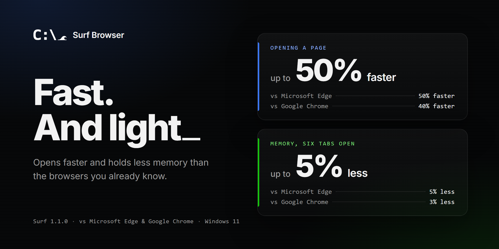
</p>

Surf uses the same Chromium engine as Edge, without Edge's extra background services, and tells background tabs to give memory back. With **Keep Surf ready in the background** on, it waits from the moment you sign in and opens almost instantly.

<sub>* Tested on one Windows 11 PC against Microsoft Edge 156 and Google Chrome 156, each on a fresh profile. Opening: from launch to a loaded page, with Keep Surf ready in the background on. Memory: all of the browser's processes added up, with one tab open and Block ads off, since Edge and Chrome block no ads by default. Results vary with the PC and the sites you visit.</sub>

## Features

| Type, don't click | Tabs that tidy themselves |
| :--- | :--- |
| **Sites by name.** `youtube`, `github` and `wikipedia` open the site. A bare address like `example.com` opens it, and anything else is a search. A leading `?` always searches. | **Smart grouping.** Tabs from the same site sit together under one label that you can collapse. |
| **Real commands.** `start`, `cd`, `back`, `copy`, `tree`, `ping`, `type` and many more, each with its own `/?` help. | **Sleeping tabs.** By default, background tabs sleep after 5 minutes and free their memory after 30. Tabs playing media or downloading are left alone. |
| **Suggestions as you type.** Matching commands, sites and tabs appear above the prompt, each with what it does. Tab takes one. Up and Down bring back your last 50 commands. | **Workspaces.** `cd \work` switches to a separate set of tabs, and `cd \` comes back. |
| **Chains and scripts.** `start github & start wikipedia` runs both. `batch add morning start github` saves a script you run by typing `morning`. | **Closed by mistake?** Ctrl+Shift+T reopens the last 20 closed tabs. |
| **Your own shortcuts.** `doskey yt=start youtube.com/results?search_query=$*`, then `yt lofi beats`. | **Split view.** `split github` shows a second page beside the one you are on. `split off` goes back to one. |
| **Link hints.** `f` puts a short label on every link. Type the label to follow it, without the mouse. | **Efficiency mode.** On battery, background tabs sleep after 1 minute and free their memory after 10. |

| Read the web your way | Private and light |
| :--- | :--- |
| **Built-in ad blocker.** uBlock Origin Lite is on by default. Surf keeps it up to date and checks every update against its published SHA-256. | **No telemetry.** No analytics and no crash reports. The only requests Surf makes by itself are its own update check and the ad blocker's. [Details](docs/PRIVACY.md). |
| **Force dark mode.** Bundled Dark Reader turns bright sites dark. | **One folder.** Settings, history, bookmarks and browser data live in `%LOCALAPPDATA%\SurfBrowser`. Delete it and the app folder, and Surf is gone. |
| **Text mode.** `mode text` shows a page as monospace text in your console colors, with no pictures or videos. `type` prints the page's text into the console. | **Clear on exit.** Optionally wipe cookies, history and site data every time you close Surf. Third-party cookie blocking and tracking prevention are built in. |
| **Find on the page.** `find "text"` marks every match and lists them in the console. `find 3` jumps to the third. | **Private tabs.** `start /private` opens a tab that stays out of your history and forgets its sign-ins when the last one closes. |
| **Screenshots.** `snip` saves the part of the page you see, `snip /full` the whole page. | **Task manager.** `tasklist` shows how much memory each tab uses. `taskkill 3` or `taskkill /im youtube` closes tabs. |
| **Picture-in-picture.** `pip` floats the video, and auto PiP can do it when you switch tabs. | **Updates itself.** Surf checks for a new version once a day and has it ready for your next start, checked against the SHA-256 GitHub publishes. `ver /update` checks right away. |

| Make it yours | Feels like home |
| :--- | :--- |
| **Colors.** All 16 Command Prompt colors with `color`. Try `color 0A`. | **CMD to the core.** A `C:\Web>` prompt, `cls`, `echo`, `rem`, `tree`, `ver`, `.bat` scripts, and errors you will recognise. |
| **Console.** Choose Consolas, Cascadia Mono or Code, Lucida Console or Courier New, an underscore, block or bar cursor, and a console 1 to 10 lines tall. `size` and `mini` resize it on the fly. | **Keyboard first.** Ctrl+L jumps to the console and F6 swaps between page and console, Ctrl+T and Ctrl+W open and close tabs, and Ctrl+1 to 9 switches tabs. [All shortcuts](docs/SHORTCUTS.md). |
| **Bookmarks you type.** `bookmark add news`, then just type `news`. | **A few secrets.** Some commands are not in `help`. |

## Screenshots

<table>
  <tr>
    <td width="50%">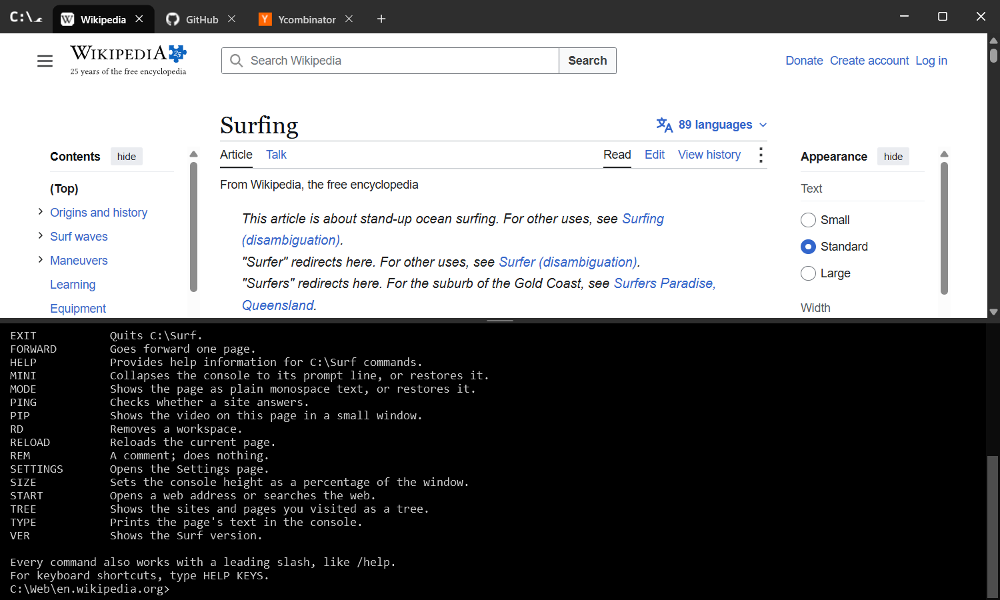<br><sub><code>help</code> lists every command. The console grows for a long answer, and Esc shrinks it back.</sub></td>
    <td width="50%">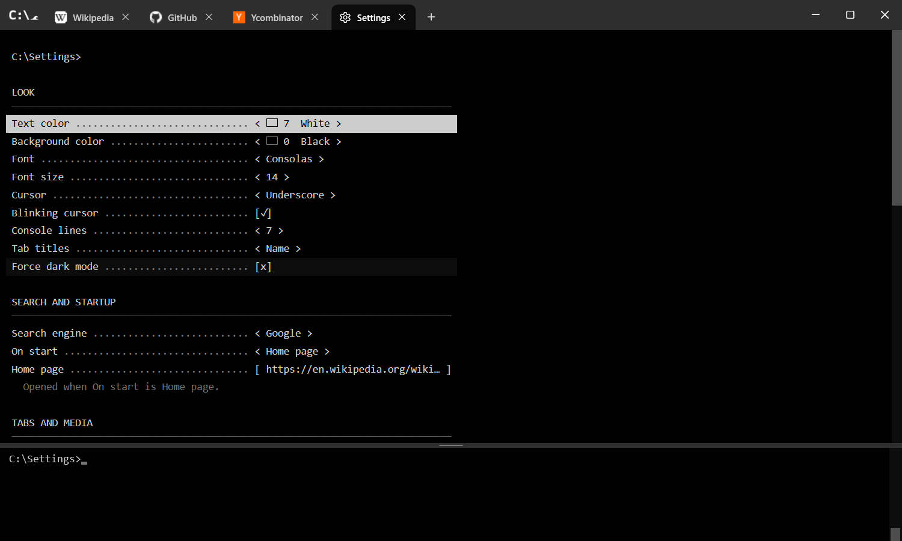<br><sub><code>settings</code> opens a DOS-style Settings page you drive with the arrow keys.</sub></td>
  </tr>
  <tr>
    <td width="50%">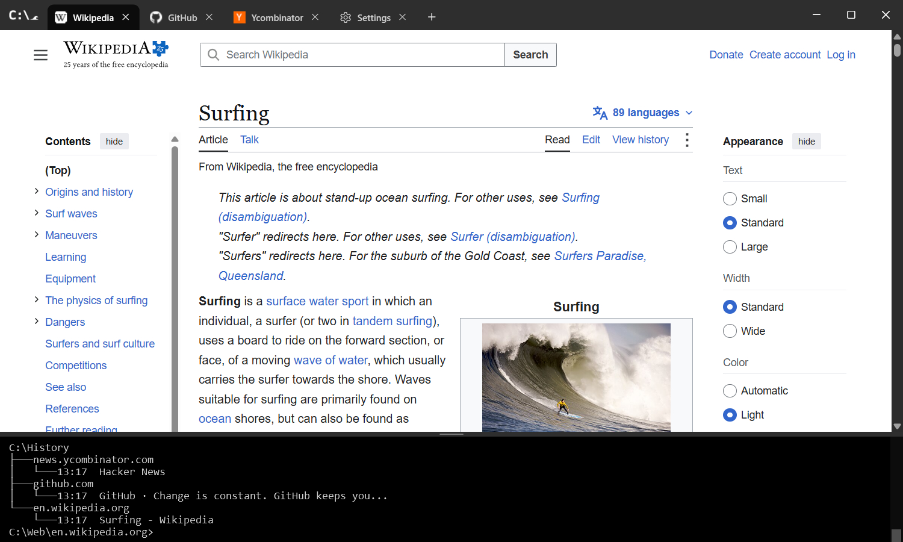<br><sub><code>tree</code> shows your history the way <code>tree</code> shows folders.</sub></td>
    <td width="50%">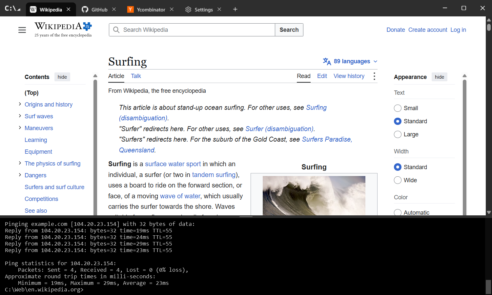<br><sub><code>ping</code> checks whether a site answers, just like the real one.</sub></td>
  </tr>
  <tr>
    <td width="50%">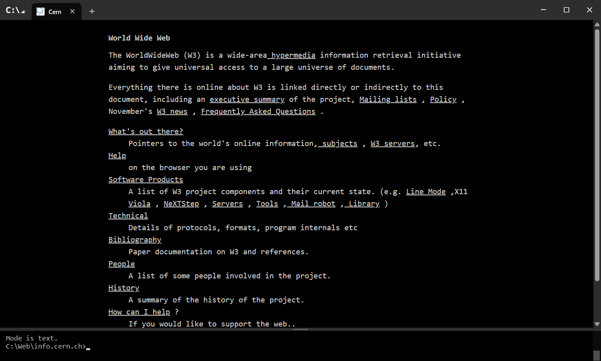<br><sub><code>mode text</code> on the first website ever made.</sub></td>
    <td width="50%">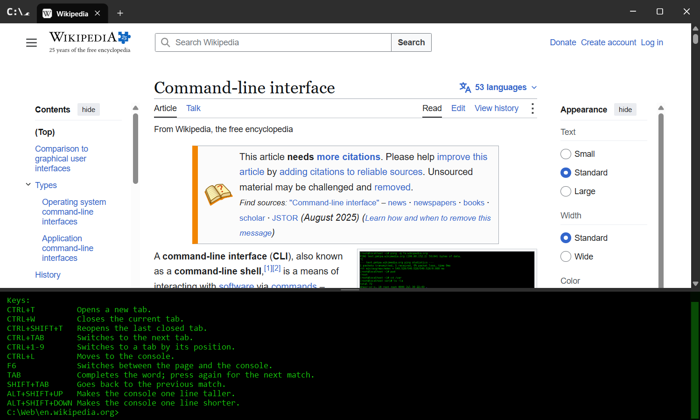<br><sub><code>color 0A</code> for the classic look, and <code>help keys</code> for the shortcuts.</sub></td>
  </tr>
  <tr>
    <td colspan="2">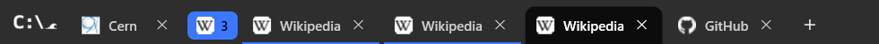<br><sub>Smart grouping keeps tabs from one site together under a single label you can collapse.</sub></td>
  </tr>
</table>

## Get started

1. **Download.** Open the [latest release](https://github.com/gajishere/surf-browser-releases/releases/latest) and download `Surf-<version>-win-x64-setup.exe`.
2. **Install.** Run it and choose **Next** a few times. Surf installs just for you, so it needs no admin rights, and it adds itself to the Start menu. Prefer no installer? Take the portable zip instead (see below).
3. **Type.** The cursor is already in the console. Try these:

| Type | What happens |
| :--- | :--- |
| `wikipedia` | Opens Wikipedia in a new tab. |
| `best pizza dough` | Searches with your search engine (Google by default, changeable in `settings`). |
| `?github` | Searches for the word instead of opening the site. |
| `cd example.com` | Opens the address in the current tab. `cd ..` goes back. |
| `bookmark add wiki` | Saves the page. Type `wiki` to open it again. |
| `tree` | Shows the sites and pages you visited today. |
| `help` | Lists every command. `help start` explains one. |

> [!NOTE]
> Surf is not code-signed yet, so Windows SmartScreen may say *Windows protected your PC* the first time you run it. Choose **More info**, then **Run anyway**. Download Surf only from this repository's [Releases](https://github.com/gajishere/surf-browser-releases/releases) page, and [check the SHA-256](#verify-your-download) if you want to be sure the file is intact.

### Which file should I download?

| File | Size | Choose it if |
| :--- | :--- | :--- |
| **`Surf-<version>-win-x64-setup.exe`** | about 51 MB | **Recommended.** Installs Surf with a Start menu shortcut and an uninstaller. Everything Surf needs is inside. |
| `Surf-<version>-win-x64.zip` | about 65 MB | You want a portable copy. Unzip it anywhere, for example `C:\Apps\Surf`, and run `SurfBrowser.exe`. |
| `Surf-<version>-win-x64-small.exe` | about 11 MB | You already have the [.NET 10 Desktop Runtime](https://dotnet.microsoft.com/download/dotnet/10.0) (x64). Without it, the file shows a message with a link to the download instead of starting. |
| `SHA256SUMS.txt` | | Checksums for all three files. |

All of them run the same Surf at the same speed, and all of them update themselves. GitHub's *Source code* archives contain only this repository's documentation, not the app.

### System requirements

- Windows 10 or Windows 11, 64-bit (x64).
- The Microsoft Edge WebView2 Runtime. It comes with Windows 11 and is already installed on most Windows 10 PCs. If it is missing, Surf prints `ERR: the web engine is not installed.` and you can get it from [Microsoft](https://developer.microsoft.com/microsoft-edge/webview2/) (choose the Evergreen Runtime).

### Verify your download

In PowerShell, in the folder where you saved the file:

```powershell
Get-FileHash .\Surf-1.2.1-win-x64-setup.exe -Algorithm SHA256
```

Compare the hash with the matching line in `SHA256SUMS.txt` from the same release.

### Update

Surf updates itself: once a day it checks for a new version and gets it ready for your next start. Type `ver /update` to check right away, or turn it off with *Update Surf automatically* in `settings`. Your settings, bookmarks, history, scripts and workspaces stay where they are, in `%LOCALAPPDATA%\SurfBrowser`. To hear about new versions, choose **Watch → Custom → Releases** at the top of this page.

### Uninstall

If you used the installer, open **Settings → Apps → Installed apps**, find **Surf Browser** and choose **Uninstall**. It asks whether to delete your settings, bookmarks and history too. For the zip or small exe, close Surf, delete the folder or file, and delete `%LOCALAPPDATA%\SurfBrowser`. See [Privacy](docs/PRIVACY.md#remove-everything).

## Documentation

| Guide | What is in it |
| :--- | :--- |
| [Commands](docs/COMMANDS.md) | Every command, how input is understood, completion, chaining and scripts. |
| [Shortcuts](docs/SHORTCUTS.md) | Keyboard and mouse shortcuts. |
| [Settings](docs/SETTINGS.md) | Every option on the Settings page, its default and where it is saved. |
| [Privacy](docs/PRIVACY.md) | What Surf keeps on your PC, what it sends, and how to remove everything. |
| [Changelog](CHANGELOG.md) | What changed in each version. |

## Frequently asked questions

<details>
<summary><strong>Is Surf based on Chrome or Edge?</strong></summary>

Surf draws pages with the Microsoft Edge WebView2 runtime, which is Edge's Chromium engine. Sites look and behave as they do in Edge. The window, tabs, console, commands, settings and data handling are Surf's own.

</details>

<details>
<summary><strong>Can I install extensions?</strong></summary>

Not in this version. Surf ships with one built-in extension, uBlock Origin Lite, for the **Block ads** setting.

</details>

<details>
<summary><strong>Can I import bookmarks or passwords from another browser?</strong></summary>

Not in this version. Bookmarks in Surf are names you type, so `bookmark add <name>` on a page is the way to add them for now.

</details>

<details>
<summary><strong>How do I make it look like the classic green terminal?</strong></summary>

Type `color 0A`. Type `color` on its own to go back to the default. For a permanent change of colors, font or cursor, use `settings`.

</details>

<details>
<summary><strong>Where does Surf keep my data?</strong></summary>

Settings, history, bookmarks, scripts, workspaces and the browser profile are all in `%LOCALAPPDATA%\SurfBrowser`. Downloads go to your download folder. The [privacy guide](docs/PRIVACY.md) lists every file, how long it is kept and what **Clear data on exit** removes.

</details>

<details>
<summary><strong>Is the source code available?</strong></summary>

Not at this time. You are welcome to report bugs and suggest features in [Issues](https://github.com/gajishere/surf-browser-releases/issues). The open-source components Surf includes are listed, with their licenses, in [THIRD-PARTY-NOTICES.md](THIRD-PARTY-NOTICES.md).

</details>

## Feedback and support

- **Found a bug?** [Open a bug report](https://github.com/gajishere/surf-browser-releases/issues/new?template=bug_report.yml). Typing `ver` in Surf shows your version.
- **Have an idea?** [Suggest a feature](https://github.com/gajishere/surf-browser-releases/issues/new?template=feature_request.yml), ideally written as the command you wish you could type.
- **Found a security problem?** Please report it privately. See [SECURITY.md](SECURITY.md).

More in [SUPPORT.md](SUPPORT.md) and [CONTRIBUTING.md](CONTRIBUTING.md).

## Built with

- [Microsoft Edge WebView2](https://developer.microsoft.com/microsoft-edge/webview2/), the engine that draws every page.
- [.NET 10](https://dotnet.microsoft.com/) and WPF.
- [uBlock Origin Lite](https://github.com/uBlockOrigin/uBOL-home) by Raymond Hill and contributors (GPLv3), for ad blocking.
- [Dark Reader](https://github.com/darkreader/darkreader) (MIT), for Force dark mode.

## License

Surf Browser is free to download and use. Copyright © 2026 Surf Browser. All rights reserved. The bundled third-party components keep their own licenses; see [THIRD-PARTY-NOTICES.md](THIRD-PARTY-NOTICES.md).

Surf is an independent project, not affiliated with or endorsed by Microsoft. Windows, Command Prompt, Microsoft Edge and WebView2 are trademarks of the Microsoft group of companies.
